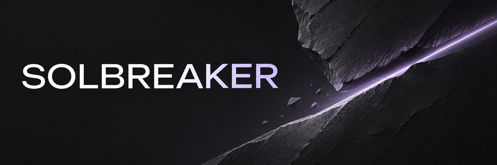

# Solbreaker



A self-hosted multiplayer tank server with a desktop launcher and terminal interface.
**Compatible with build 11.21.0.1235_7376187.**

[Download the alpha](https://github.com/unisequence/Solbreaker/releases/tag/v0.1.0-alpha.4) ·
[Report a bug](https://github.com/unisequence/Solbreaker/issues/new/choose) ·
[Руководство на русском](README.ru.md)

Solbreaker includes accounts, a garage, multiplayer rooms, 7×7 bot battles,
base capture, supremacy and battle results. Run a local server for yourself,
host a LAN game, or connect to another server. Tanks, maps and bot settings
are selected inside the game.

Solbreaker is in public alpha. Expect bugs, incomplete mechanics and changes
between versions. Back up server data before updating. The project does not
include the game client or its assets; you need your own compatible copy.
Setup creates a separate client and applies build-pinned executable and UI
adapters. Their scope and validation are described in [Client patches](docs/CLIENT_PATCHES.md).

## Start playing

### Windows x64

1. Download `Solbreaker-0.1.0-alpha.4-windows-x64.zip` from the release page.
2. Extract it into a writable folder and open **`launch-gui.vbs`**.
3. Click **Set up game**. Select your compatible game folder and a separate
   destination for the Solbreaker client.
4. Choose **On this computer** to prepare a local server, or **On another
   server** to use a server owner's connection profile. Finish setup and click
   **Play**. For a local game, you can click **Prepare maps** first. The
   launcher starts your server and shows which map it is preparing. You can
   click **Play** while that work continues.

The Windows archive contains a private Python runtime, GUI/TUI dependencies,
PyBullet and all five native libraries. No separate Python, Rust or WSL
installation is needed. `launch-tui.cmd` opens the terminal interface.
To add a branded shortcut, open **Settings → Create desktop shortcut**.
A verified copy of the game is enough to prepare and run the Windows client
without Steam installed.

If you need the pinned build, the wizard opens Steam Console and copies the
depot command. Wait for `Depot download complete`, then verify the files in
the wizard. The depot is about 21 GiB, roughly 30 minutes at 100 Mbps before
verification. On Windows, budget around 45 GiB if the depot and the prepared
client share a disk. If the depot is already present, allow about 22 GiB
on the destination disk. The temporary copy becomes the finished client.

If Steam reports an unavailable depot, check your account access and retry
the exact command from the wizard. For recurring network download errors,
see [Steam's download troubleshooting](https://help.steampowered.com/en/faqs/view/21F5-8D5D-0141-7A5E).
A SHA-256 error calls for a fresh verification of the pinned source folder.
Retry preparation in a new destination after verification succeeds.

### Linux x86-64

Install Python 3.11+, its development headers, a C/C++ toolchain and Rust 1.85+.
On Debian/Ubuntu, the system dependencies are:

```sh
sudo apt install python3 python3-venv python3-dev build-essential pkg-config curl
```

Install Rust using [rustup](https://rust-lang.org/tools/install/) if it is not
already available. Extract the source archive, enter its `Solbreaker` folder
and run:

```sh
./launch-gui.sh
```

The launcher installs its Python dependencies and guides you through setup.
For the Linux game client, select your Steam installation and Proton runtime.
Keep the original game folder in place: the separate client links to its assets.

### Updating

In releases from alpha.2 onward, click **Update** in the launcher sidebar. Close the
game and stop your local server first. The launcher downloads the matching
GitHub release, checks its SHA-256 and restarts after installing it. Your
settings, client and server data are kept.

To upgrade from alpha.1, close the old launcher and extract the new archive
into a separate folder. Copy your old `runtime/manager.json` into the new
`runtime` folder and keep the old folder if your client or server data lives
there. Start the new launcher and check the paths in **Settings**. On Linux,
run `./.venv/bin/python tools/build_native.py` from the new folder after the
first launcher start if you host a local server.

If installation is interrupted, check `runtime/launcher-update.log`. When the
launcher reports an interrupted replacement, keep the old installation and
extract a verified release into a separate folder. Follow the same settings
migration steps above. [Recovery steps in Russian](docs/INSTALL.ru.md#если-обновление-прервалось).

### Play with a friend

1. **Host.** In **My server → Set up LAN / VPN access**, select the network
   adapter and start the server.
2. **Player.** Choose **On another server** in the setup wizard and select
   the host from the discovered servers. An existing prepared client can
   switch servers through the wizard with the game closed.

Discovery uses IPv4 broadcasts on LAN and direct queries to visible peers
when the local Tailscale client is running. If discovery is unavailable, the
host can export `connection.json` with **My server → Share connection**.
For direct internet play, configure HTTPS, a reachable public IPv4, the two
UDP ports and the access list. [Network guide in Russian](docs/SERVER.ru.md#сеть-и-https).

### Server only

The server needs the compatible game resources even when no client is running
on the host. It does not need Steam or a graphical session.

```sh
./setup.sh --game /path/to/owned/game
./start-server.sh --state data --log-file data/server.log
```

On Windows, use `setup.ps1 -Game 'D:\Games\CompatibleBuild'` followed by
`start-server.ps1`. The portable archive supplies the runtime and native libraries.
The initial account is written to `data/private/initial-login.txt`; players can
also register an email, nickname and password inside the game.

Prepared local play works offline. Remote play needs a network path to the
server. Keep the original game folder available on Linux, where the prepared
client links to its resources.

## What is included

- Native ground physics in Rust, verified on Linux and Windows x64. See the [verification scope](docs/NATIVE_PHYSICS.md).
- A 60 Hz simulation; bot decisions run at 15 Hz.
- GUI and TUI launchers, with Russian and English in the GUI.
- Local and remote server profiles, account registration and server backups.
- Bot navigation, combat maneuvers, several battle rules and post-battle results.
- Optional detailed diagnostic logging for reproducing bugs.

This is not a complete reproduction of every feature of the original service.
Internal damage-module coverage is incomplete. Bot decisions and terrain
interactions still need broader testing. See [native physics](docs/NATIVE_PHYSICS.md)
for implementation details and the limits of the recorded performance results.

## Report a problem

Open an [issue](https://github.com/unisequence/Solbreaker/issues/new/choose) with
your release version, client/server OS, map, tank and reproduction steps.
A short replay or the relevant log excerpt helps. Reports in English or
Russian are welcome. Remove passwords and tokens before attaching anything;
do not upload server databases, backups or the game files.

For a diagnostic server run:

```sh
./start-server.sh --state data --log-file data/server.log --diagnostic-log
```

Security reports go through [private vulnerability reporting](SECURITY.md).
Development and contribution notes are in [CONTRIBUTING.md](CONTRIBUTING.md).

## License and credits

Solbreaker's own code is licensed under **AGPL-3.0-only**. See [LICENSE](LICENSE).
The source and Windows release archives include the project sources and build
scripts. Third-party components retain their own licenses, listed in
[THIRD_PARTY_NOTICES.md](THIRD_PARTY_NOTICES.md) and [licenses](licenses/README.md).

This is an independent community project. Game files remain separately obtained
resources. Compatibility research, library references and AI-assisted development
and artwork are documented in [Sources and credits](docs/SOURCES.md).
